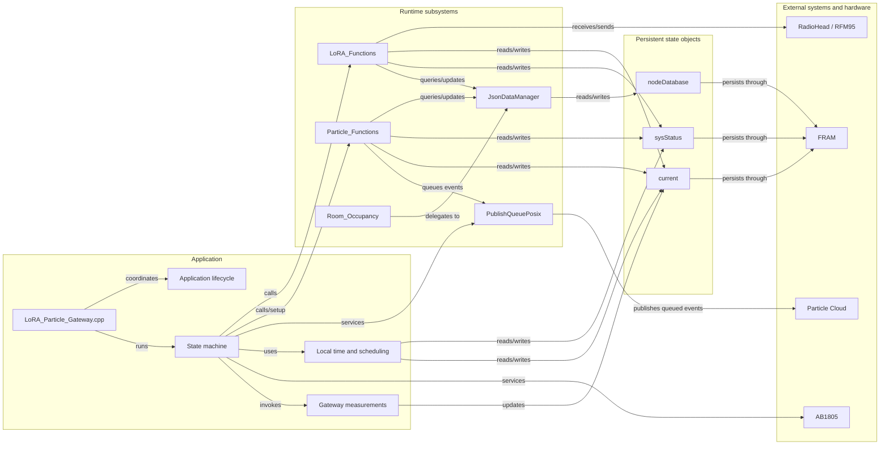
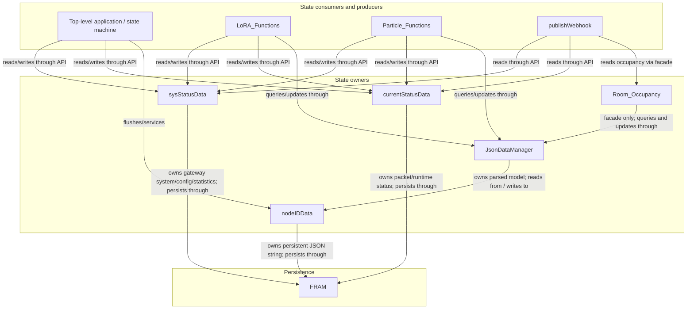
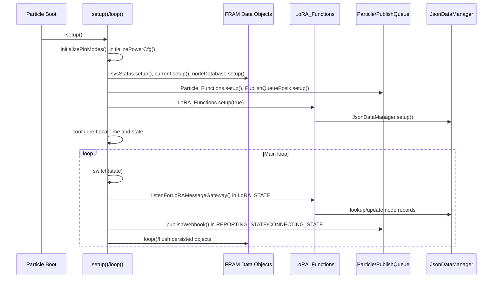
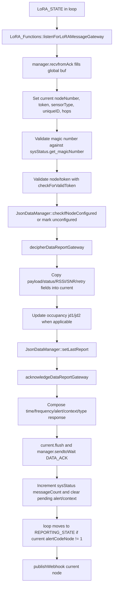

# AR-001 - MAFC Gateway Architecture Discovery

Date: 2026-07-18

Scope: MAFC Gateway firmware in `LoRA-Particle-Gateway`. This document describes the implementation currently present in the MAFC Gateway repository. It does not compare against the Reference Gateway and does not recommend changes.

## Evidence Base

Governing project documentation reviewed before source inspection:

- `README.md`
- `docs/AI_WORKFLOW.md`
- `docs/reliability/reliability-review.md`

Runtime source and library files inspected:

- `project.properties`
- `src/config.h`
- `src/LoRA_Particle_Gateway.cpp`
- `src/LoRA_Functions.h`
- `src/LoRA_Functions.cpp`
- `src/Particle_Functions.h`
- `src/Particle_Functions.cpp`
- `src/JsonDataManager.h`
- `src/JsonDataManager.cpp`
- `src/MyPersistentData.h`
- `src/MyPersistentData.cpp`
- `src/Room_Occupancy.h`
- `src/Room_Occupancy.cpp`
- `src/device_pinout.h`
- `src/device_pinout.cpp`
- `src/take_measurements.h`
- `src/take_measurements.cpp`
- `lib/PublishQueuePosixRK/src/PublishQueuePosixRK.h`
- `lib/PublishQueuePosixRK/src/PublishQueuePosixRK.cpp`

The project documentation establishes the MAFC Gateway as an indoor, wall-powered gateway that remains awake, supports up to 50 nearby dense nodes, receives node reports hourly and on occupancy changes, preserves existing node firmware and protocol compatibility, and performs MAFC-specific per-node configuration including space, scanning pattern, and in/out orientation. `README.md` lists the current MAFC node install commands and documents gateway alert codes, Particle command shapes, data payload assignments, join payload assignments, and JSON database fields. `docs/AI_WORKFLOW.md` and `docs/reliability/reliability-review.md` define this initial investigation as documentation-only and identify the MAFC repository as the writable documentation target.

## 1. Executive Summary

The MAFC Gateway firmware is a Particle-based gateway application that receives private LoRa messages from deployed nodes, maintains node configuration and occupancy-related state, acknowledges nodes with time/reporting/configuration information, and publishes gateway, node, and space data to Particle Cloud events for downstream integrations. The application is built around a single top-level state machine in `src/LoRA_Particle_Gateway.cpp`, with hardware, LoRa, cloud command, persistence, JSON node database, occupancy aggregation, and measurement responsibilities split into separate source files.

At startup, `setup()` initializes pins, power configuration, FRAM-backed persistent objects, Particle functions, the AB1805 RTC/watchdog, the publish queue, the LoRa radio, and local time conversion. It then forces connectivity mode to connected operation in the current code path by setting `sysStatus.set_connectivityMode(1)` and enters `CONNECTING_STATE`. The main `loop()` switches among initialization, idle, sleep, LoRa listening, reporting, cloud connecting, cloud disconnecting, and error/deep-power-down states. In the current `src/config.h`, `TRANSPORT_MODE` is `0` for WiFi, serial logging is at info level, the default LoRa window is 5 minutes, the stay-connected window is 60 minutes, the default reporting frequency sent to nodes is 3600 seconds, and the timezone string is `SGT-8`.

LoRa communication is owned by `LoRA_Functions`, a heap-allocated singleton whose `setup(true)` initializes the RF95 radio, encrypted RadioHead driver, and `RHMesh` manager at gateway address 0. The gateway listens with `listenForLoRAMessageGateway()`, validates the message magic number from `sysStatus`, captures current packet fields into the FRAM-backed `current` object, checks or assigns tokens and node numbers, dispatches to data-report or join-request decoders, and sends data or join acknowledgements. The LoRa packet layouts are documented in comments in `src/LoRA_Functions.h` and implemented in `src/LoRA_Functions.cpp`.

Node configuration and node state are stored as a JSON document in the FRAM-backed `nodeDatabase` object. `JsonDataManager` owns parsing and mutation of that JSON through a global `JsonParserStatic<3072, 550> jp`. Each node object contains fields such as `node`, `uID`, `type`, compressed join payload `p`, pending alert `pend`, alert context `cont`, last report `lrep`, and type-specific data fields `jd1` and `jd2`. For occupancy nodes, comments and code in `JsonDataManager.cpp` define `jd1` as occupancy net and `jd2` as occupancy gross. Join payload compression/decompression maps occupancy space, placement, and multi-entrance flags into one byte.

Occupancy management is implemented by `Room_Occupancy`, a singleton facade over `JsonDataManager`. It exposes reset and aggregation functions such as `resetAllCounts()`, `resetNetCounts()`, `setOccupancyNetForNode()`, `getRoomNet()`, and `getRoomGross()`. The actual data reads and writes occur in `JsonDataManager` functions such as `getOccupancyNetBySpace()`, `getOccupancyGrossBySpace()`, `resetOccupancyNetCounts()`, `resetOccupancyCounts()`, `resetSpace()`, and `setOccupancyNetForNode()`.

Cloud integration is implemented through Particle Cloud functions and queued Particle publishes. `Particle_Functions::setup()` registers one Particle function named `Commands`, and `jsonFunctionParser(String command)` parses JSON command arrays to operate on the gateway or nodes. It can change reporting frequency, stay-connected mode, open/close/break settings, node sensor type, occupancy mounting configuration, node alert codes and contexts, occupancy counts, space resets, and other node configuration alerts. Outbound cloud events are queued with `PublishQueuePosix::instance().publish()` from `publishWebhook()`, `JsonDataManager`, `Particle_Functions`, and LoRa acknowledgements.

Persistent storage is primarily FRAM through `StorageHelperRK::PersistentDataFRAM` and the MB85RC64 instance in `src/MyPersistentData.cpp`. Three long-lived persistent data objects exist: `sysStatus` at FRAM offset 0, `current` at offset 100, and `nodeDatabase` at offset 200. The publish queue library also contains RAM and file-backed event queue mechanisms in `lib/PublishQueuePosixRK`, and the application initializes it with `PublishQueuePosix::instance().setup()`.

External interfaces include the RFM95 LoRa radio over SPI, FRAM and AB1805 RTC/watchdog over I2C, Particle Cloud over WiFi in the current configuration, serial logging, GPIO for radio reset/interrupt/user switch/LED/module power/TMP36 sense, Particle time and system event APIs, and Particle reset/cloud/publish APIs.

## Architecture at a Glance

### Subsystem Dependency Diagram

The top-level application file coordinates startup, state transitions, scheduling checks, watchdog service, and gateway measurements. LoRa packets and Particle Cloud commands are separate ingress paths: `LoRA_Functions` handles radio traffic, while `Particle_Functions` handles the `Commands` cloud function. `JsonDataManager` is the central access layer for node records. `Room_Occupancy` delegates occupancy reads and updates to `JsonDataManager` rather than owning a separate store. Persistent state is concentrated in `sysStatus`, `current`, and `nodeDatabase`, each backed by FRAM. Outbound cloud events are queued through `PublishQueuePosix` before reaching Particle Cloud.

### Primary State Ownership Diagram

The firmware's authoritative mutable state is concentrated in `sysStatus`, `current`, and `nodeDatabase`/`JsonDataManager`. `sysStatusData` owns gateway system, configuration, and statistics fields; `currentStatusData` owns the current packet and transient runtime status fields; `nodeIDData` owns the persistent JSON string stored in FRAM. `JsonDataManager` owns the parsed JSON representation and the mutation interface used by other modules. `Room_Occupancy` is a facade over occupancy fields in the node database, not a separate occupancy store. LoRa handling, cloud commands, the top-level state machine, and webhook publication interact with these owners through their APIs.

## 2. Repository Inventory

| File | Purpose | Key Classes / Functions | Notes |
|---|---|---|---|
| `README.md` | Project overview, MAFC install configuration, alert codes, Particle command examples, payload definitions. | Not source code. | Defines operational context and protocol/command expectations used by the firmware. |
| `docs/AI_WORKFLOW.md` | Governing reliability workflow and repository roles. | Not source code. | States documentation-only initial investigation and Node firmware compatibility constraints. |
| `docs/reliability/reliability-review.md` | Reliability review notebook and constraints. | Not source code. | Records MAFC operating facts and investigation domains. |
| `project.properties` | Particle project dependencies. | Dependency declarations. | Includes `PublishQueuePosixRK`, `LocalTimeRK`, `CryptoLW-RK`, `AB1805_RK`, `MB85RC256V-FRAM-RK`, `StorageHelperRK`, `JsonParserGeneratorRK`, and `Base64RK`. |
| `src/config.h` | Compile-time transport, logging, scheduling, and timezone configuration. | `TRANSPORT_MODE`, `SERIAL_LOG_LEVEL`, `DEFAULT_LORA_WINDOW`, `STAY_CONNECTED`, `DEFAULT_REPORTING_FREQUENCY_SECONDS`, `TIME_CONFIG`. | Current checkout sets WiFi transport and Singapore timezone. |
| `src/LoRA_Particle_Gateway.cpp` | Main application entry point and state machine. | `setup()`, `loop()`, `publishWebhook()`, `publishStateTransition()`, `outOfMemoryHandler()`, `userSwitchISR()`, `softDelay()`. | Owns top-level lifecycle, scheduled reset windows, cloud connect/disconnect, and webhook composition. |
| `src/LoRA_Functions.h` | LoRa packet format comments and `LoRA_Functions` API. | `LoRA_Functions` singleton declaration. | Documents data report, data ack, join request, and join ack byte layouts. |
| `src/LoRA_Functions.cpp` | LoRa radio setup, message receive/decode, token checks, data/join acknowledgements. | `LoRA_Functions::setup()`, `initializeRadio()`, `listenForLoRAMessageGateway()`, `decipherDataReportGateway()`, `acknowledgeDataReportGateway()`, `decipherJoinRequestGateway()`, `acknowledgeJoinRequestGateway()`, `setNodeToken()`, `checkForValidToken()`. | Defines global RF95/RHEncryptedDriver/RHMesh objects and global LoRa buffer. |
| `src/Particle_Functions.h` | Particle Cloud command class API. | `Particle_Functions` singleton declaration, `jsonFunctionParser()`, `disconnectFromParticle()`. | Declares single cloud command parser. |
| `src/Particle_Functions.cpp` | Particle system mode, logging handler, Particle command registration and command execution. | `SYSTEM_MODE(SEMI_AUTOMATIC)`, `SYSTEM_THREAD(ENABLED)`, `STARTUP(System.enableFeature(FEATURE_RESET_INFO))`, `Particle_Functions::setup()`, `jsonFunctionParser()`, `disconnectFromParticle()`. | Parses JSON commands with `JsonParserStatic<1024, 80>`. |
| `src/MyPersistentData.h` | Persistent data object declarations and stored field layout. | `sysStatusData`, `currentStatusData`, `nodeIDData`; macros `sysStatus`, `current`, `nodeDatabase`. | Documents FRAM-backed fields and getters/setters. |
| `src/MyPersistentData.cpp` | FRAM object construction, setup, validation, initialization, getters/setters, node JSON persistence. | `MB85RC64 fram(Wire, 0)`, `sysStatusData::setup()`, `currentStatusData::setup()`, `nodeIDData::setup()`, `nodeIDData::resetNodeIDs()`, `nodeIDData::set_nodeIDJson()`. | Uses FRAM offsets 0, 100, and 200. |
| `src/JsonDataManager.h` | JSON node database manager API. | `JsonDataManager` singleton and node, occupancy, helper, compression functions. | Declares functions used by LoRa, commands, and occupancy aggregation. |
| `src/JsonDataManager.cpp` | JSON node database parsing, mutation, node lookup, occupancy state, alert queues, inactive space reset, join payload compression. | `JsonParserStatic<3072, 550> jp`, `setup()`, `findNodeNumber()`, `getNodeNumberForUniqueID()`, `setAlertCode()`, `setAlertContext()`, `setJsonData1()`, `setJsonData2()`, `resetInactiveSpaces()`, `saveNodeDatabase()`. | Owns persistent node JSON content through `nodeDatabase`. |
| `src/Room_Occupancy.h` | Occupancy facade API. | `Room_Occupancy` singleton declaration. | Specific to room occupancy aggregation. |
| `src/Room_Occupancy.cpp` | Occupancy facade implementation. | `resetAllCounts()`, `resetNetCounts()`, `setOccupancyNetForNode()`, `getRoomNet()`, `getRoomGross()`. | Delegates to `JsonDataManager`; also defines `roomGrossArray[64]`. |
| `src/device_pinout.h` | Pin declarations and hardware init API. | Pin extern declarations, `initializePinModes()`, `initializePowerCfg()`. | Defines application-visible hardware pins. |
| `src/device_pinout.cpp` | Pin assignments and pin-mode initialization. | `RFM95_CS`, `RFM95_RST`, `RFM95_INT`, `BUTTON_PIN`, `BLUE_LED`, `WAKEUP_PIN`, `TMP36_SENSE_PIN`, `initializePinModes()`, `initializePowerCfg()`. | Initializes GPIO for radio, button, LED, module power, and sensor pins. |
| `src/take_measurements.h` | Gateway measurement API. | `takeMeasurements()`, `tmp36TemperatureC()`, `batteryState()`, `isItSafeToCharge()`, `getSignalStrength()`. | Used by gateway webhook publication. |
| `src/take_measurements.cpp` | Gateway temperature, battery, charge-safety, and signal-strength measurements. | `FuelGauge fuelGauge`, `takeMeasurements()`, `tmp36TemperatureC()`, `batteryState()`, `isItSafeToCharge()`, `getSignalStrength()`. | Cellular-specific PMIC behavior is compiled only when `TRANSPORT_MODE == 1`. |
| `lib/PublishQueuePosixRK/src/PublishQueuePosixRK.h` | Publish queue library API and RAM/file queue structures. | `PublishQueuePosix`, `PublishQueueEvent`, `PublishQueueFileHeader`. | Application uses singleton publish queue for Particle events. |
| `lib/PublishQueuePosixRK/src/PublishQueuePosixRK.cpp` | Publish queue implementation. | `PublishQueuePosix::setup()`, `loop()`, `publishCommon()`, `newRamEvent()`, `writeQueueToFiles()`, `readQueueFile()`. | Starts `BackgroundPublishRK`, registers system handlers, uses RAM queue and POSIX files. |

## 3. Application Lifecycle

### Program Entry Point

Particle firmware entry points are `setup()` and `loop()` in `src/LoRA_Particle_Gateway.cpp`. System behavior is configured in `src/Particle_Functions.cpp` with `SYSTEM_MODE(SEMI_AUTOMATIC)`, `SYSTEM_THREAD(ENABLED)`, and `STARTUP(System.enableFeature(FEATURE_RESET_INFO))`.

### Initialization Sequence

`setup()` performs the following sequence:

| Step | Code Reference | Description |
|---|---|---|
| Serial wait | `setup()` | Calls `waitFor(Serial.isConnected, 10000)`. |
| Pin setup | `initializePinModes()` | Configures button, wake pin, blue LED, sensor interrupt/power, LED power, and RFM95 reset pin. |
| Power config | `initializePowerCfg()` | Currently returns `true`; commented code shows Particle power configuration not active. |
| Persistent objects | `sysStatus.setup()`, `current.setup()`, `nodeDatabase.setup()` | Loads FRAM-backed persistent data. |
| Connectivity mode write | `sysStatus.set_connectivityMode(4)` then later `sysStatus.set_connectivityMode(1)` | The current code first sets mode 4 and then unconditionally sets mode 1 before entering connecting state. |
| Particle command setup | `Particle_Functions::instance().setup()` | Registers the `Commands` Particle function. |
| RTC/watchdog | `ab1805.withFOUT(D8).setup()`, `ab1805.setWDT(AB1805::WATCHDOG_MAX_SECONDS)` | Initializes AB1805 and watchdog. |
| Out-of-memory event | `System.on(out_of_memory, outOfMemoryHandler)` | Captures out-of-memory event parameter in global `outOfMemory`. |
| Publish queue | `PublishQueuePosix::instance().setup()` | Initializes queued publishing. |
| LoRa setup | `LoRA_Functions::instance().setup(true)` | Initializes radio as gateway and calls `JsonDataManager::instance().setup()`. |
| Local time | `LocalTime::instance().withConfig(LocalTimePosixTimezone(TIME_CONFIG))`, `conv.withCurrentTime().convert()` | Sets timezone conversion. |
| Time/connection decision | `if (Time.isValid()) ... else state = CONNECTING_STATE` and subsequent unconditional connected-mode block | Logs time validity, then sets connected mode and `CONNECTING_STATE`. |
| User switch interrupt | `attachInterrupt(BUTTON_PIN, userSwitchISR, CHANGE)` | Sets `userSwitchDectected` when button changes. |
| Initial state fallback | `if (state == INITIALIZATION_STATE) state = SLEEPING_STATE` | Only applies if state was not moved earlier. |

### Object Construction

Long-lived objects are constructed in several ways:

- Global/static objects: `SystemSleepConfiguration config`, `AB1805 ab1805(Wire)`, `LocalTimeConvert conv`, RF95/RadioHead globals in `LoRA_Functions.cpp`, `MB85RC64 fram(Wire, 0)`, `FuelGauge fuelGauge`, `JsonParserStatic<3072, 550> jp`, and pin constants.
- Heap-allocated singleton objects: `LoRA_Functions`, `Particle_Functions`, `JsonDataManager`, `Room_Occupancy`, `sysStatusData`, `currentStatusData`, `nodeIDData`, and `PublishQueuePosix` allocate their singleton instances with `new` in their `instance()` functions.
- FRAM-backed singleton data objects are constructed with `StorageHelperRK::PersistentDataFRAM` base constructors in `MyPersistentData.cpp`.

### Hardware Initialization

`initializePinModes()` in `src/device_pinout.cpp` configures `BUTTON_PIN` as `INPUT_PULLUP`, `WAKEUP_PIN` as `INPUT`, `BLUE_LED` as `OUTPUT`, `INT_PIN` as `INPUT`, `MODULE_POWER_PIN` and `LED_POWER_PIN` as outputs, drives `LED_POWER_PIN` and `MODULE_POWER_PIN` low, configures `RFM95_RST` as output, and drives `RFM95_RST` high. `LoRA_Functions::initializeRadio()` then toggles `RFM95_RST` low/high, initializes the `RHMesh` manager, sets RF95 frequency, transmit power, modem configuration, low data rate, and manager timeout.

### Configuration Loading

Compile-time configuration comes from `src/config.h`. Runtime configuration comes from FRAM-backed `sysStatus` and JSON-backed node records. `sysStatusData::setup()` calls `fram.begin()`, sets a 500 ms save delay, loads data, sets a random `tokenCore`, and logs it. `nodeIDData::setup()` similarly loads the JSON string from FRAM. `JsonDataManager::setup()` loads `nodeDatabase.get_nodeIDJson()` into the global JSON parser and resets node IDs if parsing fails.

### LoRa Initialization

`LoRA_Functions::setup(true)` calls `initializeRadio()`, sets the gateway node number to `GATEWAY_ADDRESS` 0 in `sysStatus`, logs gateway initialization, and invokes `JsonDataManager::instance().setup()`.

The LoRa implementation uses:

- `RH_RF95 rf95(RFM95_CS, RFM95_INT)`
- `Speck myCipher`
- `RHEncryptedDriver driver(rf95, myCipher)`
- `RHMesh manager(driver, GATEWAY_ADDRESS)`
- Global `uint8_t buf[RH_MESH_MAX_MESSAGE_LEN]`

### Cloud Initialization

`Particle_Functions::setup()` registers a Particle function named `Commands` mapped to `Particle_Functions::jsonFunctionParser`. The application does not call `Particle.connect()` during setup directly; cloud connection occurs in `CONNECTING_STATE` inside `loop()`. `PublishQueuePosix::instance().setup()` starts queued publishing support before LoRa setup.

### Main Loop and State Machine

`loop()` switches over `state`, then services common tasks after the state switch:

- `ab1805.loop()`
- `PublishQueuePosix::instance().loop()`
- `sysStatus.loop()`
- `current.loop()`
- `nodeDatabase.loop()`
- `LoRA_Functions::instance().loop()`
- out-of-memory reset check
- gateway alert check

State behavior:

| State | Primary Behavior | Exit Path |
|---|---|---|
| `INITIALIZATION_STATE` | Initial enum value. | `setup()` normally changes state before loop operation. |
| `IDLE_STATE` | Publishes state transition, checks gateway alert, moves to LoRa. | `ERROR_STATE` or `LoRA_STATE`. |
| `SLEEPING_STATE` | Calculates next reporting boundary, configures `System.sleep()`, stops/resumes AB1805 watchdog around sleep, then wakes. | `IDLE_STATE`. |
| `LoRA_STATE` | Opens LoRa listening window, computes open/closed and break state, handles inactive-space checks, receives LoRa messages, optionally transitions to reporting or connecting. | `REPORTING_STATE`, `CONNECTING_STATE`, `ERROR_STATE`, or `SLEEPING_STATE`; if connected mode is 1, remains in LoRa except hourly connect check. |
| `REPORTING_STATE` | Calls `publishWebhook(current.get_nodeNumber())`, clears current node alert code. | `LoRA_STATE`. |
| `CONNECTING_STATE` | Publishes gateway webhook, handles serial-only transport, calls `Particle.connect()`, records connection timestamp/duration, syncs time, logs signal strength, and chooses next state. | `LoRA_STATE` or `DISCONNECTING_STATE`. |
| `DISCONNECTING_STATE` | Waits 90 seconds and until `PublishQueuePosix::getCanSleep()` is true, then optionally disconnects from Particle. | `SLEEPING_STATE`. |
| `ERROR_STATE` | Publishes an alert if connected, clears gateway alert, and after 30 seconds calls `ab1805.deepPowerDown()`. | Deep power down path. |

### Timers and Scheduled Activities

Scheduled and periodic behavior is implemented with time checks inside `loop()`, not explicit application timer objects:

- `SLEEPING_STATE` calculates `wakeInSeconds` using `sysStatus.get_frequencySeconds()` and `Time.now()`.
- `LoRA_STATE` uses `startLoRAWindow` and `connectionWindow` to bound the LoRa listening period when not in connected mode.
- `LoRA_STATE` checks inactive spaces once per hour after returning from `REPORTING_STATE` through `lastCheckedInactiveSpaces` and `Time.hour()`.
- `LoRA_STATE` resets all counts once per hour while outside configured open hours using `lastResetOccupancyWhenClosed` and `Room_Occupancy::resetAllCounts()`.
- Break handling uses local day/hour/minute from `LocalTimeConvert` and calls `Room_Occupancy::resetNetCounts()` when break starts.
- `CONNECTING_STATE` has a 10-minute connection timeout.
- `DISCONNECTING_STATE` waits 90 seconds and publish-queue readiness before disconnecting.
- `ERROR_STATE` waits 30 seconds before AB1805 deep power down.

### Reset Handling

Reset and restart paths present in code:

- `System.on(out_of_memory, outOfMemoryHandler)` records the out-of-memory parameter, and `loop()` calls `System.reset()` when `outOfMemory >= 0`.
- Particle command `reset` in `jsonFunctionParser()` can reset node data, gateway system/current data, or node current/all data; gateway node-data reset and stay-mode false paths call `System.reset()`.
- Particle command `pwr` sets `sysStatus.alertCodeGateway`, which drives `ERROR_STATE` and then AB1805 deep power down.
- `ERROR_STATE` calls `ab1805.deepPowerDown()` after a delay.
- `STARTUP(System.enableFeature(FEATURE_RESET_INFO))` enables reset information, but source inspected does not show code reading reset info.

### Shutdown or Restart Paths

There is no general application shutdown routine. Observed restart/power-down paths are `System.reset()` from command and out-of-memory handling, and `ab1805.deepPowerDown()` from `ERROR_STATE`. `Particle_Functions::disconnectFromParticle()` disconnects from Particle and, when compiled for cellular transport, powers off cellular.

## 4. Major Subsystems

### LoRa Communications

| Field | Description |
|---|---|
| Purpose | Receive node data and join messages, validate network/token/node identity, decode payloads, update current/node database state, and send data/join acknowledgements. |
| Primary files | `src/LoRA_Functions.h`, `src/LoRA_Functions.cpp`, `src/device_pinout.cpp`, `src/config.h` |
| Major classes | `LoRA_Functions`; external `RH_RF95`, `RHEncryptedDriver`, `RHMesh`, `Speck` |
| Responsibilities | Radio initialization, receive buffer polling, magic-number validation, token validation, node number assignment, data report decoding, join request decoding, ack payload composition, RadioHead send/receive. |
| Inputs | LoRa mesh packets in global `buf`; `sysStatus` magic number/frequency/token core; JSON node database; Particle time. |
| Outputs | Updated `current` fields, JSON database mutations, LoRa acknowledgements, log/status publishes. |
| Dependencies | RadioHead RF95/RHMesh, CryptoLW Speck, pin definitions, `MyPersistentData`, `JsonDataManager`, `PublishQueuePosixRK`, Particle time/logging. |

### Node Management

| Field | Description |
|---|---|
| Purpose | Maintain node number to unique ID mapping, sensor type, compressed join payload, pending node alert, alert context, last report time, and type-specific node data. |
| Primary files | `src/JsonDataManager.h`, `src/JsonDataManager.cpp`, `src/MyPersistentData.h`, `src/MyPersistentData.cpp` |
| Major classes | `JsonDataManager`, `nodeIDData` |
| Responsibilities | Load JSON from FRAM, parse JSON, find/add nodes, check configuration, map unique IDs to node numbers, set/get type, set/get alerts, set last report, save JSON back to FRAM. |
| Inputs | LoRa unique IDs/node numbers, Particle commands, current packet data, FRAM JSON string. |
| Outputs | FRAM node JSON string, pending alert/context fields, published diagnostic/status events. |
| Dependencies | `JsonParserGeneratorRK`, `StorageHelperRK`, FRAM, `current`, `sysStatus`, `PublishQueuePosixRK`. |

### Occupancy Management

| Field | Description |
|---|---|
| Purpose | Aggregate and reset occupancy net/gross counts by space and node. |
| Primary files | `src/Room_Occupancy.h`, `src/Room_Occupancy.cpp`, `src/JsonDataManager.cpp` |
| Major classes | `Room_Occupancy`, `JsonDataManager` |
| Responsibilities | Provide facade methods for room net/gross retrieval, all-count reset, net-count reset, and manual node net-count setting; perform JSON scans and updates for occupancy fields. |
| Inputs | JSON node records (`type`, compressed payload, `jd1`, `jd2`, `lrep`), LoRa occupancy reports, Particle commands, local open/break schedule. |
| Outputs | Updated `jd1`/`jd2`, pending node reset/override alerts, Ubidots occupancy publish events. |
| Dependencies | `JsonDataManager`, `PublishQueuePosixRK`, `current`, Particle connection/time. |

### Configuration

| Field | Description |
|---|---|
| Purpose | Hold compile-time transport/scheduling/logging/timezone settings and runtime gateway/node configuration. |
| Primary files | `src/config.h`, `src/MyPersistentData.h`, `src/MyPersistentData.cpp`, `src/Particle_Functions.cpp`, `src/JsonDataManager.cpp` |
| Major classes | `sysStatusData`, `nodeIDData`, `Particle_Functions`, `JsonDataManager` |
| Responsibilities | Define build settings, persist gateway operating fields, parse cloud commands, update node join payload and pending alerts. |
| Inputs | Compile-time macros, FRAM, Particle `Commands` JSON, LoRa join payloads. |
| Outputs | Updated FRAM fields, updated JSON node database, node alert codes and ack payloads. |
| Dependencies | Particle Cloud function API, JSON parser, FRAM storage. |

### Persistence

| Field | Description |
|---|---|
| Purpose | Persist gateway system data, current packet data, and node JSON database. |
| Primary files | `src/MyPersistentData.h`, `src/MyPersistentData.cpp`, `src/JsonDataManager.cpp` |
| Major classes | `sysStatusData`, `currentStatusData`, `nodeIDData` |
| Responsibilities | Load, validate, initialize, update, and flush FRAM-backed data structures. |
| Inputs | Runtime setters from state machine, LoRa handling, command parsing, JSON manager. |
| Outputs | FRAM writes via `StorageHelperRK::PersistentDataFRAM`. |
| Dependencies | `MB85RC256V-FRAM-RK`, `StorageHelperRK`, `Wire`, `JsonParserGeneratorRK`. |

### Particle Cloud Integration

| Field | Description |
|---|---|
| Purpose | Receive cloud commands and publish gateway/node/occupancy/status/alert events. |
| Primary files | `src/Particle_Functions.cpp`, `src/LoRA_Particle_Gateway.cpp`, `src/JsonDataManager.cpp`, `lib/PublishQueuePosixRK/src/PublishQueuePosixRK.cpp` |
| Major classes | `Particle_Functions`, `PublishQueuePosix` |
| Responsibilities | Register `Commands`, parse and execute command JSON, connect/disconnect from Particle, sync time, queue publish events, compose webhook event payloads. |
| Inputs | Particle function command string, state machine connect/disconnect decisions, data in `current`/`sysStatus`/JSON. |
| Outputs | Particle events including `Ubidots-LoRA-Gateway-v1`, `Ubidots-LoRA-Counter-v1`, `Ubidots-LoRA-Occupancy-v2`, `Ubidots-LoRA-Sensor-v1`, `Ubidots_Command_Hook`, `Alert`, `status`, `cmd`, and `nodeData`. |
| Dependencies | Particle API, PublishQueuePosixRK, BackgroundPublishRK, LocalTimeRK, JSON parser. |

### Scheduling

| Field | Description |
|---|---|
| Purpose | Control LoRa listening windows, cloud connection cadence, open/closed resets, break resets, sleep duration, and reporting frequency sent to nodes. |
| Primary files | `src/LoRA_Particle_Gateway.cpp`, `src/config.h`, `src/MyPersistentData.h` |
| Major classes | None dedicated; implemented in `loop()` using state-local static variables and `sysStatus` fields. |
| Responsibilities | Calculate wake boundary, manage LoRa windows, force hourly connect check, reset counts outside open hours, reset net counts during break, update frequency sent to nodes. |
| Inputs | `Time.now()`, `Time.hour()`, local time conversion, `sysStatus` open/close/break/frequency/connectivity fields. |
| Outputs | State transitions, reset calls, node ack frequency fields, publish/connect actions. |
| Dependencies | Particle time, LocalTimeRK, AB1805 watchdog/sleep coordination. |

### Diagnostics and Logging

| Field | Description |
|---|---|
| Purpose | Expose runtime flow, node data, command results, alerts, reset/power paths, and communication metrics. |
| Primary files | `src/Particle_Functions.cpp`, `src/LoRA_Particle_Gateway.cpp`, `src/LoRA_Functions.cpp`, `src/JsonDataManager.cpp`, `src/MyPersistentData.cpp`, `src/take_measurements.cpp` |
| Major classes | `SerialLogHandler`, `PublishQueuePosix` |
| Responsibilities | Serial logging through `Log.info()`, queued cloud status/alert publishes, `printNodeData()`, webhook payloads, command result publishes. |
| Inputs | Runtime events and state. |
| Outputs | Serial log lines and Particle events. |
| Dependencies | Particle logging, PublishQueuePosixRK. |

### Watchdog

| Field | Description |
|---|---|
| Purpose | Use AB1805 RTC/watchdog for watchdog and deep power-down behavior. |
| Primary files | `src/LoRA_Particle_Gateway.cpp`, `src/device_pinout.cpp` |
| Major classes | `AB1805 ab1805(Wire)` |
| Responsibilities | Initialize AB1805 on D8 FOUT, set watchdog max seconds, stop/resume watchdog around sleep, service AB1805 in loop, deep power down in error state. |
| Inputs | State machine transitions, error/gateway alert state. |
| Outputs | Watchdog service and AB1805 deep power down. |
| Dependencies | `AB1805_RK`, I2C `Wire`, D8 wake/FOUT pin. |

### Statistics

| Field | Description |
|---|---|
| Purpose | Track runtime counters and communication metrics. |
| Primary files | `src/MyPersistentData.h`, `src/LoRA_Functions.cpp`, `src/LoRA_Particle_Gateway.cpp`, `src/take_measurements.cpp` |
| Major classes | `sysStatusData`, `currentStatusData` |
| Responsibilities | Store gateway message count, reset count, last connection time/duration, node RSSI/SNR/hops/retry/retransmission delay, battery/temp values. |
| Inputs | LoRa packet fields, Particle connection timing, measurements. |
| Outputs | FRAM fields, webhook payloads, logs. |
| Dependencies | Particle time, LoRa driver, measurement functions. |

### Utilities

| Field | Description |
|---|---|
| Purpose | Provide pin setup, measurement conversion, local delay processing, join payload compression/decompression. |
| Primary files | `src/device_pinout.cpp`, `src/take_measurements.cpp`, `src/LoRA_Particle_Gateway.cpp`, `src/JsonDataManager.cpp` |
| Major classes | None dedicated. |
| Responsibilities | GPIO setup, TMP36 conversion, battery/signal measurement, `softDelay()`, `compressData()`, `decompressData()`. |
| Inputs | ADC readings, Particle APIs, payload bytes. |
| Outputs | Current data fields, compressed/decompressed payload bytes. |
| Dependencies | Particle API, `current`, `sysStatus`. |

## 5. Control Flow

### Incoming LoRa Data Packet

Detailed flow:

1. `loop()` in `LoRA_STATE` calls `LoRA_Functions::instance().listenForLoRAMessageGateway()`.
2. `listenForLoRAMessageGateway()` calls `manager.recvfromAck(buf, &len, &from, &dest, &id, &messageFlag, &hops)`.
3. The function stores `from`, token, sensor type, unique ID, and hops into `current`.
4. It validates `buf[0..1]` against `sysStatus.get_magicNumber()`.
5. It derives `lora_state` from the RadioHead message flag.
6. It checks whether `nodeNumber` and token are valid using `checkForValidToken()`.
7. If the token/node combination is not valid, it uses `JsonDataManager::checkIfNodeConfigured()` to distinguish configured nodes with invalid tokens from unconfigured nodes; unconfigured nodes are marked with temp node number, node number 255, and alert code 255.
8. For `DATA_RPT`, it calls `decipherDataReportGateway()`.
9. `decipherDataReportGateway()` copies payload bytes 10-17 and status bytes 18-27 into `current`.
10. For occupancy sensor types 10-19, if `JsonDataManager::getAlertCode()` returns 0, it writes occupancy net to `jd1` and gross to `jd2` with `setJsonData1()` and `setJsonData2()`.
11. It writes last report time with `setLastReport()` and changes `lora_state` to `DATA_ACK`.
12. Back in `listenForLoRAMessageGateway()`, any pending updated reporting frequency is moved from `updatedfrequencySeconds` to `frequencySeconds`.
13. `acknowledgeDataReportGateway()` composes ack bytes for token, current time, frequency, alert code, alert context, and sensor type.
14. During break time, occupancy nodes with nonzero reported net count can trigger `JsonDataManager::setOccupancyNetForNode(nodeNumber, 0)` before ack composition.
15. The ack is sent with `manager.sendtoWait(buf, 16, nodeAddress, DATA_ACK)`.
16. On ack success, it increments `sysStatus.messageCount`, clears JSON pending alert and context, and returns true.
17. `LoRA_STATE` logs receipt and transitions to `REPORTING_STATE` unless the current alert code is 1.
18. `REPORTING_STATE` calls `publishWebhook(current.get_nodeNumber())`, clears `current.alertCodeNode`, and returns to `LoRA_STATE`.

### Incoming LoRa Join Request

1. `listenForLoRAMessageGateway()` receives a message and identifies `JOIN_REQ` from the message flag.
2. `decipherJoinRequestGateway()` currently sets `current.sensorType` to 10 for join requests, captures payload and retry bytes, assigns a unique ID if bytes 6 and 7 are both 255, calls `JsonDataManager::findNodeNumber()`, ensures token validity, sets `current.alertCodeNode(1)`, and changes `lora_state` to `JOIN_ACK`.
3. `findNodeNumber()` scans JSON nodes for matching `uID`; if none exists, it appends a new node object with node number, unique ID, type, payload, pending alert, context, last report, `jd1`, and `jd2`, saves the database, and then stores configuration from the join payload with `setJoinPayload()`.
4. `acknowledgeJoinRequestGateway()` composes ack bytes including magic number, assigned node number, token, current time, frequency, alert code, type, unique ID, new node number, and join payload from JSON.
5. It sends the join ack with `manager.sendtoWait(buf, 25, nodeAddress, JOIN_ACK)`.

### Particle Command Flow

1. `Particle_Functions::setup()` registers Particle function `Commands`.
2. Particle Cloud invokes `jsonFunctionParser(String command)`.
3. `jsonFunctionParser()` parses the command JSON with local `JsonParserStatic<1024, 80> jp`.
4. It iterates up to 10 command objects under the `cmd` array.
5. For nonzero `node`, it maps node unique ID to node number with `JsonDataManager::getNodeNumberForUniqueID()`.
6. It dispatches by `fn` string to gateway functions, node database changes, occupancy operations, or node alert/context updates.
7. It logs and optionally publishes `cmd` and `Ubidots_Command_Hook` events indicating success, invalid command, or failure.

### Gateway Webhook Publication Flow

1. `publishWebhook(nodeNumber)` returns immediately if `Time.isValid()` is false.
2. For node 0, it calls `takeMeasurements()`, composes `Ubidots-LoRA-Gateway-v1`, and includes device ID, battery, temperature, reset count, gateway alerts, message count, and timestamp.
3. For sensor types 1-9, it composes `Ubidots-LoRA-Counter-v1` with counter payloads and node telemetry.
4. For sensor types 10-19, it composes `Ubidots-LoRA-Occupancy-v2` with node unique ID, battery, space number, and `Room_Occupancy` net/gross totals.
5. For sensor types 20-29, it composes `Ubidots-LoRA-Sensor-v1`.
6. If Particle is connected, it enqueues the event with `PublishQueuePosix::instance().publish(webhook, data, PRIVATE | WITH_ACK)`.

### Open/Closed and Break Reset Flow

1. On entry to `LoRA_STATE`, `conv.withCurrentTime().convert()` obtains local time.
2. If local hour is within `sysStatus.openTime` through `sysStatus.closeTime`, `current.openHours` is set true.
3. Outside open hours, once per hour, the code resets reporting frequency to `DEFAULT_REPORTING_FREQUENCY_SECONDS` and calls `Room_Occupancy::resetAllCounts()`, then sets `current.openHours` false.
4. Weekday/weekend break settings are selected from `sysStatus.breakTime`, `breakLengthMinutes`, `weekendBreakTime`, and `weekendBreakLengthMinutes`.
5. During a configured break window, if `current.onBreak` was 0, it is set to 1 and `Room_Occupancy::resetNetCounts()` is called.
6. Outside the break window, `current.onBreak` is set to 0.

### Inactive Space Reset Flow

1. After returning from `REPORTING_STATE` into `LoRA_STATE`, once per hour when `sysStatus.connectivityMode == 0`, the code calls `JsonDataManager::resetInactiveSpaces(3600)`.
2. `resetInactiveSpaces()` groups non-counter nodes by decompressed space using a local `std::vector<std::vector<std::vector<int>>>`.
3. It checks whether every node in a space has a last report older than the provided threshold.
4. For inactive spaces, it publishes/logs and calls `resetSpace(space)`.
5. `resetSpace()` sets occupancy nodes in the space to pending alert 12/context 0, sets `jd1` to 0, updates last report, and may publish an occupancy update.

## 6. Data Ownership

| Runtime Data | Owner | Lifecycle | Read Paths | Write Paths |
|---|---|---|---|---|
| Node records | `JsonDataManager` owns the parsed in-memory JSON; `nodeIDData` owns FRAM storage for the JSON string. | Loaded during `nodeDatabase.setup()` and `JsonDataManager::setup()`; mutated during commands, joins, reports, resets; flushed through `nodeDatabase`. | `JsonDataManager` getters, LoRa join/data ack paths, `Particle_Functions`, `Room_Occupancy`. | `JsonDataManager::saveNodeDatabase()`, `nodeIDData::set_nodeIDJson()`, `nodeDatabase.flush()`. |
| Configuration | Compile-time owner is `src/config.h`; runtime owner is `sysStatusData`; per-node config owner is JSON node records. | Compile-time constants fixed at build; runtime `sysStatus` loaded from FRAM and modified by setup, commands, state machine; node config stored in compressed payload `p`. | `loop()`, `LoRA_Functions`, `Particle_Functions`, `publishWebhook()`. | `sysStatus` setters, `Particle_Functions::jsonFunctionParser()`, `JsonDataManager::setType()`, `setJoinPayload()`, `setAlertCode()`, `setAlertContext()`. |
| Occupancy state | JSON node records via `JsonDataManager`; `Room_Occupancy` provides facade access. | Updated on LoRa data reports, manual commands, reset windows, break windows, inactive-space checks. | `Room_Occupancy::getRoomNet()`, `getRoomGross()`, `publishWebhook()`, `JsonDataManager` occupancy functions. | `setJsonData1()`, `setJsonData2()`, `resetOccupancyNetCounts()`, `resetOccupancyCounts()`, `resetSpace()`, `setOccupancyNetForNode()`. |
| LoRa packets | Global `buf` in `src/LoRA_Functions.cpp` holds receive and response bytes. | Allocated globally for program lifetime; overwritten for each received/acknowledged packet. | `listenForLoRAMessageGateway()`, decode/ack functions. | RadioHead receive fills `buf`; ack functions write response bytes. |
| Publish queues | `PublishQueuePosix` singleton owns RAM queue and file queue. | Initialized in setup; looped in main loop; events allocated as RAM events and may be written to files. | Application checks `getCanSleep()` in `DISCONNECTING_STATE`; library reads queues internally. | Application calls `PublishQueuePosix::publish()`; library `publishCommon()`, `writeQueueToFiles()`, `readQueueFile()`. |
| Persistent data | `sysStatusData`, `currentStatusData`, `nodeIDData` own FRAM-backed structures. | Constructed as singletons, loaded in setup, flushed in loop and explicit flush calls. | Getter methods throughout application. | Setter methods throughout application, `flush(false/true)`. |
| Runtime statistics | Split between `sysStatus` and `current`. | Loaded from FRAM; updated during connection, LoRa reception, webhook publication, measurements, and reset paths. | `publishWebhook()`, logs, command functions. | `LoRA_Functions`, `LoRA_Particle_Gateway`, `takeMeasurements()`, `Particle_Functions`. |

Ownership uncertainty: `Room_Occupancy.cpp` defines `uint16_t roomGrossArray[64]`, but inspected code does not read or write that array. The active occupancy values appear to be owned by JSON `jd1`/`jd2` fields instead.

## 7. Memory Map

This section identifies allocation locations and long-lived memory as implemented.

### Long-Lived and Global Objects

| Object | File | Allocation / Lifetime | Purpose |
|---|---|---|---|
| `SystemSleepConfiguration config` | `src/LoRA_Particle_Gateway.cpp` | Global | Sleep configuration object. |
| `AB1805 ab1805(Wire)` | `src/LoRA_Particle_Gateway.cpp` | Global | RTC/watchdog/deep power-down. |
| `LocalTimeConvert conv` | `src/LoRA_Particle_Gateway.cpp` | Global | Main local time conversion. |
| `State state`, `State oldState`, `stateNames` | `src/LoRA_Particle_Gateway.cpp` | Global | Main state machine. |
| `outOfMemory`, `userSwitchDectected` | `src/LoRA_Particle_Gateway.cpp` | Global | System event/interrupt flags. |
| `RH_RF95 rf95`, `Speck myCipher`, `RHEncryptedDriver driver`, `RHMesh manager` | `src/LoRA_Functions.cpp` | Global | LoRa radio and mesh stack. |
| `uint8_t buf[RH_MESH_MAX_MESSAGE_LEN]` | `src/LoRA_Functions.cpp` | Global | Shared LoRa receive/response buffer. |
| `JsonParserStatic<3072, 550> jp` | `src/JsonDataManager.cpp` | Global | Parsed node database buffer/tokens. |
| `LocalTimeConvert conv2` | `src/JsonDataManager.cpp` | Global | Node-data print timestamp conversion. |
| `MB85RC64 fram(Wire, 0)` | `src/MyPersistentData.cpp` | Global | FRAM device abstraction. |
| `FuelGauge fuelGauge` | `src/take_measurements.cpp` | Global | Battery state helper. |
| Pin constants | `src/device_pinout.cpp` | Global constants | Hardware pin mapping. |
| `roomGrossArray[64]` | `src/Room_Occupancy.cpp` | Global | Defined but not observed as used in inspected code. |

### Singleton-Style Objects and Dynamic Allocation

The following singleton `instance()` functions allocate with `new` when first called:

- `LoRA_Functions::instance()` in `src/LoRA_Functions.cpp`
- `Particle_Functions::instance()` in `src/Particle_Functions.cpp`
- `JsonDataManager::instance()` in `src/JsonDataManager.cpp`
- `Room_Occupancy::instance()` in `src/Room_Occupancy.cpp`
- `sysStatusData::instance()` in `src/MyPersistentData.cpp`
- `currentStatusData::instance()` in `src/MyPersistentData.cpp`
- `nodeIDData::instance()` in `src/MyPersistentData.cpp`
- `PublishQueuePosix::instance()` in `lib/PublishQueuePosixRK/src/PublishQueuePosixRK.cpp`

### Dynamic Allocation and Heap Usage Locations

| Location | Allocation | Purpose | Free / Lifetime |
|---|---|---|---|
| Singleton `instance()` functions | `new ClassName()` | Long-lived singleton creation. | No delete path observed; intended program lifetime. |
| `JsonDataManager::saveNodeDatabase()` | `malloc(tok->end - tok->start + 1)` | Temporary serialized JSON copy before `nodeDatabase.set_nodeIDJson()`. | Explicit `free(tempBuf)` on success. |
| `JsonDataManager::resetInactiveSpaces()` | `std::vector<std::vector<std::vector<int>>> spaceNodes(maxSpaces)` | Groups nodes by space during inactive-space scan. | Automatic local object releases when function returns. |
| `PublishQueuePosix::newRamEvent()` | `new char[sizeof(PublishQueueEvent) + strlen(eventData)]` | Allocate queued publish event. | Library deletes after file write or queue clear/read handling. |
| `PublishQueuePosix::readQueueFile()` | `new char[eventSize]` | Allocate event read from file queue. | Library deletes on corrupted read; other ownership continues in publish flow outside inspected excerpt. |

### `String` Usage

Observed application `String` usage includes:

- `Particle_Functions::jsonFunctionParser(String command)` and local `String variable`, `String function`, `String placementStr`, `String multiStr`.
- `JsonDataManager::setup()` through `nodeDatabase.get_nodeIDJson()` return value and length logging.
- `nodeIDData::resetNodeIDs()` local `String blank`.
- `nodeIDData::get_nodeIDJson()` returns `String` filled by `getValueString()`.
- `LoRA_Particle_Gateway.cpp` uses `conv.timeStr().substring(0, 3)` to derive `dayString`, and multiple Particle/Time calls return `String` values used for logging.
- `Particle.deviceID().c_str()` is used in webhook composition.

### STL Containers

- `JsonDataManager::resetInactiveSpaces()` uses `std::vector<std::vector<std::vector<int>>>` to group nodes by space.
- `PublishQueuePosixRK` uses `std::deque` for its RAM event queue, as declared in `PublishQueuePosixRK.h`.

### Buffer Ownership

| Buffer | Owner | Size / Source | Usage |
|---|---|---|---|
| `buf` | `LoRA_Functions.cpp` | `RH_MESH_MAX_MESSAGE_LEN` | Shared LoRa packet buffer. |
| `JsonParserStatic<3072, 550> jp` | `JsonDataManager.cpp` | 3072 byte JSON buffer, 550 tokens | Node database parse/mutation. |
| `JsonParserStatic<1024, 80> jp` | `Particle_Functions::jsonFunctionParser()` local | 1024 byte command buffer, 80 tokens | Particle command parsing. |
| `char data[256]`, `char webhook[256]` | `publishWebhook()` stack | 256 each | Event name/data composition. |
| Various `char message[128/256/622]` | JSON/LoRa/Particle functions stack | Function-local | Log and publish payload composition. |
| `nodeIDData::NodeData::nodeIDJson[3072]` | `nodeIDData` FRAM-backed struct | 3072 chars | Persistent node database string. |

### Stack-Intensive Routines Identified

The largest visible local buffers and local parser objects appear in:

- `Particle_Functions::jsonFunctionParser()`: local `JsonParserStatic<1024, 80>`, several `String` variables, and multiple local `char data[128]`/`messaging[64]` buffers.
- `publishWebhook()`: `char data[256]` and `char webhook[256]`.
- `JsonDataManager::printNodeData()`: `char data[622]`.
- `JsonDataManager` reset/set functions: several `char message[128]` or `char message[256]` buffers.

No stack size measurements were found in the inspected source.

## 8. Persistent State

| Mechanism | Technology | Purpose | Owner | Read Path | Write Path | Lifetime |
|---|---|---|---|---|---|---|
| Gateway system status | MB85RC64 FRAM through `StorageHelperRK::PersistentDataFRAM` | Gateway node number, structure version, magic number, connectivity mode, reset/message counts, connection timestamps, reporting frequency, gateway alert, schedule, token core. | `sysStatusData` | `sysStatusData::setup()` loads; getters used across application. | Setters, `sysStatus.loop()` flush, explicit `flush()`. | Persists across reset/power cycles subject to FRAM storage. |
| Current packet/status data | MB85RC64 FRAM through `StorageHelperRK::PersistentDataFRAM` | Last/current node packet fields, payloads, node telemetry, open-hours and break flags. | `currentStatusData` | `currentStatusData::setup()` loads; getters used by LoRa, publishing, occupancy. | Setters, `current.loop()` flush, `current.flush(true)` in data ack. | Persists across reset/power cycles subject to FRAM storage. |
| Node database | MB85RC64 FRAM through `StorageHelperRK::PersistentDataFRAM`; JSON string field. | Node records, unique IDs, sensor type, compressed join payload, pending alerts/context, last report, occupancy data fields. | `nodeIDData` for storage; `JsonDataManager` for parsed object and mutations. | `nodeIDData::setup()`, `nodeDatabase.get_nodeIDJson()`, `JsonDataManager::setup()`. | `JsonDataManager::saveNodeDatabase()`, `nodeIDData::set_nodeIDJson()`, `nodeDatabase.flush()`. | Persists across reset/power cycles subject to FRAM storage. |
| Publish event queue | RAM plus POSIX file queue in `PublishQueuePosixRK`. | Queue Particle publish events while disconnected or when RAM queue overflows. | `PublishQueuePosix` library. | `PublishQueuePosix::setup()` scans directory; `readQueueFile()` reads files. | `publishCommon()` creates RAM event; `writeQueueToFiles()` writes file events. | RAM events last while powered; file queue lifetime is filesystem-backed. Application code does not configure queue directory in inspected source. |
| Particle Cloud | External cloud event/integration state | Gateway publishes event payloads to webhook names and command result events. | Particle Cloud and configured integrations outside this repository. | Not read directly except command invocation into `jsonFunctionParser()`. | `PublishQueuePosix::publish()` calls throughout application. | External to firmware; lifetime unknown from source. |

EEPROM: no application use of Particle `EEPROM` APIs was found in inspected MAFC `src` files.

Flash/filesystem: application source initializes `PublishQueuePosix`; file-backed queue behavior is implemented in the library with POSIX `open`, `write`, `read`, and `close`. No direct application LittleFS/SPIFFS file API use was found in inspected MAFC `src` files.

## 9. External Interfaces

| Interface | Purpose | Files | Primary Entry Points |
|---|---|---|---|
| RFM95 LoRa radio | Receive node packets and send acknowledgements over LoRa. | `src/LoRA_Functions.cpp`, `src/device_pinout.cpp` | `initializeRadio()`, `listenForLoRAMessageGateway()`, `manager.recvfromAck()`, `manager.sendtoWait()`. |
| RadioHead mesh/encrypted driver | Addressed/reliable LoRa message transport and encryption wrapper. | `src/LoRA_Functions.cpp`, `src/LoRA_Functions.h` | `RHMesh manager`, `RHEncryptedDriver driver`, message flags `DATA_RPT`, `JOIN_REQ`, `DATA_ACK`, `JOIN_ACK`. |
| Particle Cloud | Command input, connectivity, time sync, publishes. | `src/Particle_Functions.cpp`, `src/LoRA_Particle_Gateway.cpp`, `src/JsonDataManager.cpp` | `Particle.function("Commands", ...)`, `Particle.connect()`, `Particle.connected()`, `Particle.syncTime()`, `PublishQueuePosix::publish()`. |
| WiFi | Current configured network transport. | `src/config.h`, `src/LoRA_Particle_Gateway.cpp`, `src/take_measurements.cpp` | `TRANSPORT_MODE 0`, `WiFi.RSSI()` in WiFi compile path. |
| Cellular | Alternate compile-time transport path. | `src/config.h`, `src/LoRA_Particle_Gateway.cpp`, `src/Particle_Functions.cpp`, `src/take_measurements.cpp` | `TRANSPORT_MODE 1`, `Cellular.RSSI()`, `Cellular.disconnect()`, `Cellular.off()`, `PMIC` charge control. |
| Serial | Debug/log output and startup wait. | `src/LoRA_Particle_Gateway.cpp`, `src/Particle_Functions.cpp`, `src/config.h` | `waitFor(Serial.isConnected, 10000)`, `SerialLogHandler`. |
| FRAM | Persistent storage for system/current/node database objects. | `src/MyPersistentData.cpp`, `src/MyPersistentData.h` | `MB85RC64 fram(Wire, 0)`, `PersistentDataFRAM` subclasses, `load()`, `flush()`, `setValue*()`. |
| AB1805 RTC/watchdog | Watchdog, RTC synchronization support, deep power-down path. | `src/LoRA_Particle_Gateway.cpp` | `ab1805.withFOUT(D8).setup()`, `setWDT()`, `stopWDT()`, `resumeWDT()`, `loop()`, `deepPowerDown()`. |
| GPIO | Radio reset/interrupt/chip select, user button, LED, sensor power, TMP36 analog input. | `src/device_pinout.cpp`, `src/device_pinout.h`, `src/take_measurements.cpp` | `initializePinModes()`, `digitalWrite()`, `pinMode()`, `analogRead(TMP36_SENSE_PIN)`, `attachInterrupt(BUTTON_PIN, userSwitchISR, CHANGE)`. |
| Timers/time | Scheduling, timestamps, reporting boundaries. | `src/LoRA_Particle_Gateway.cpp`, `src/JsonDataManager.cpp` | `Time.now()`, `Time.hour()`, `Time.day()`, `LocalTimeConvert`, `millis()`. |
| Publish queue filesystem | Store queued publish events in files when needed. | `lib/PublishQueuePosixRK/src/PublishQueuePosixRK.cpp` | `writeQueueToFiles()`, `readQueueFile()`, POSIX `open/read/write/close`. |
| Gateway measurement hardware/API | Gateway enclosure temperature, battery state/charge safety, signal strength. | `src/take_measurements.cpp`, `src/device_pinout.cpp` | `takeMeasurements()`, `tmp36TemperatureC()`, `batteryState()`, `isItSafeToCharge()`, `getSignalStrength()`. |

Sensors on remote nodes are not directly interfaced by this gateway firmware; their readings arrive as LoRa payload bytes decoded in `LoRA_Functions::decipherDataReportGateway()` and interpreted by `publishWebhook()` and `JsonDataManager`.

## 10. Runtime Observability

| Mechanism | Files / Functions | Observed Outputs |
|---|---|---|
| Serial logging | `SerialLogHandler` in `Particle_Functions.cpp`; `Log.info()` throughout source. | State transitions, setup status, LoRa receive/ack status, JSON updates, command parsing, connection status, reset paths. |
| State transition logging | `publishStateTransition()` in `LoRA_Particle_Gateway.cpp`. | Logs transition string from previous state to current state. |
| Gateway webhook | `publishWebhook(0)` in `LoRA_Particle_Gateway.cpp`. | `Ubidots-LoRA-Gateway-v1` event with device ID, battery, temperature, resets, alerts, message count, timestamp. |
| Counter node webhook | `publishWebhook()` sensor types 1-9. | `Ubidots-LoRA-Counter-v1` event with unique ID, hourly/daily counts, sensor type, battery, temp, resets, alert, node, RSSI, SNR, hops, timestamp. |
| Occupancy node/space webhook | `publishWebhook()` sensor types 10-19; occupancy functions in `JsonDataManager.cpp`. | `Ubidots-LoRA-Occupancy-v2` event with node unique ID, battery, space, space net, space gross. |
| Sensor node webhook | `publishWebhook()` sensor types 20-29. | `Ubidots-LoRA-Sensor-v1` event with sensor payloads, placement, battery, temp, resets, alert, node, RSSI, SNR, hops, timestamp. |
| Command result events | `Particle_Functions::jsonFunctionParser()`. | `cmd` event and `Ubidots_Command_Hook` events for success, invalid command, failure, syntax error, and event resolution. |
| Node database report | `JsonDataManager::printNodeData(bool publish)`. | Logs per-node data; when `publish` is true and Particle connected, publishes `nodeData`. |
| LoRa status events | `LoRA_Functions::acknowledgeDataReportGateway()` and `acknowledgeJoinRequestGateway()`. | `status` publish on successful ack/join when Particle connected. |
| Alerts | Multiple functions in `LoRA_Functions.cpp`, `JsonDataManager.cpp`, `Particle_Functions.cpp`, `LoRA_Particle_Gateway.cpp`. | `Alert`, `Inactive Space`, `Space Reset`, and `Setting Occupancy` events in observed paths. |
| Connection metrics | `CONNECTING_STATE`, `take_measurements.cpp`, `sysStatus` fields. | Last connection time/duration, signal strength logs, gateway webhook fields. |
| Reset/error reporting | `ERROR_STATE`, `outOfMemoryHandler()`, command parser. | Logs and publishes alert before deep power down; logs out-of-memory reset; `FEATURE_RESET_INFO` enabled but no reset-info read path observed. |
| Publish queue metrics | `PublishQueuePosixRK` library logging. | Trace logs for RAM/file queue lengths and file operations when log level permits. |

Debug commands are exposed through the single `Commands` Particle function. The command parser supports actions documented in `README.md` and implemented in `Particle_Functions::jsonFunctionParser()`.

## 11. Architecture Questions

## Open Questions

| Question | Why It Is Unclear | Files Requiring Additional Investigation |
|---|---|---|
| What publish queue directory is used at runtime? | `PublishQueuePosixRK.h` states `withDirPath()` is required, and the application calls `PublishQueuePosix::instance().setup()` without an observed `withDirPath()` call in inspected MAFC source. The library default path behavior was not fully traced. | `lib/PublishQueuePosixRK/src/PublishQueuePosixRK.h`, `lib/PublishQueuePosixRK/src/PublishQueuePosixRK.cpp`, `lib/SequentialFileRK/src/*` |
| Is `roomGrossArray[64]` part of an active or abandoned occupancy path? | `Room_Occupancy.cpp` defines the array, but inspected code did not reference it after definition. Active occupancy aggregation appears to read JSON `jd1`/`jd2`. | `src/Room_Occupancy.cpp`, full-workspace symbol references if needed. |
| Which reset-reason data is consumed, if any? | `STARTUP(System.enableFeature(FEATURE_RESET_INFO))` enables reset information, but inspected source did not show a reader or publisher for reset reason. | `src/Particle_Functions.cpp`, `src/LoRA_Particle_Gateway.cpp`, any future diagnostics files. |
| What is the intended runtime meaning of connectivity modes 0, 1, and 4 in the current MAFC build? | `sysStatusData::SysData` comments define several connectivity modes, `setup()` sets mode 4 and then unconditionally mode 1, and `loop()` explicitly branches on modes 0 and 1. The exact operational use of mode 4 in current source is not fully expressed by reachable branches inspected here. | `src/LoRA_Particle_Gateway.cpp`, `src/MyPersistentData.h`, `src/Particle_Functions.cpp`. |
| Is sleeping expected to be reachable in the current MAFC build? | Project documentation says MAFC is wall-powered and remains awake. Source still contains `SLEEPING_STATE`, but `setup()` unconditionally sets connected mode 1 and `LoRA_STATE` remains in LoRa state under mode 1 except hourly connect checks. The architectural presence of sleep is clear; its expected current reachability requires runtime confirmation. | `src/LoRA_Particle_Gateway.cpp`, `src/config.h`, runtime logs. |
| How are Particle Cloud integrations configured downstream? | Source publishes named Particle events and `README.md` names webhook/integration intent, but actual Particle integration configuration is not stored in inspected source. | Particle Console/integration configuration outside repository; `README.md` for documented event names. |
